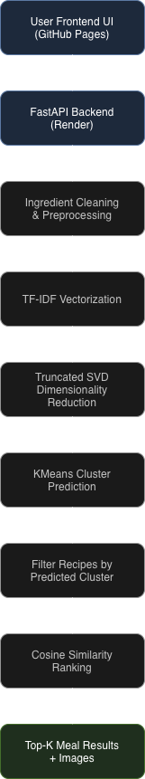

# Gohan — Ingredient-Based Meal Recommendation System

## Overview

Gohan is an ingredient-based meal recommendation system that helps users discover recipes using ingredients already available in their kitchen. The system uses unsupervised machine learning techniques to cluster recipes and generate recommendations based on ingredient similarity.

The project combines:

* Natural Language Processing (NLP)
* Unsupervised Machine Learning
* Dimensionality Reduction
* Similarity Search
* Full-stack deployment using FastAPI and GitHub Pages

The frontend provides a minimal anime-inspired user experience, while the backend performs clustering and similarity-based recommendation retrieval.

---

# Problem Statement

Many users struggle with deciding what meals to prepare using ingredients they already possess. Existing recipe platforms often:

* Require exact ingredient matches
* Prioritize keyword search over semantic similarity
* Provide overwhelming or irrelevant recipe suggestions
* Depend heavily on manual filtering

This project addresses these limitations by building an ingredient-driven recommendation engine capable of:

* Understanding ingredient similarity
* Grouping recipes into meaningful clusters
* Returning recipes closely aligned with user input
* Supporting flexible ingredient combinations

The goal is to reduce food decision fatigue while improving recipe discoverability and reducing ingredient waste.

---

# Architecture Diagram Flow

<p align="center">
  
</p>

---

# Tech Stack

## Frontend

* HTML
* CSS
* Vanilla JavaScript
* GitHub Pages

## Backend

* FastAPI
* Uvicorn
* Render

## Machine Learning

* Scikit-learn
* Pandas
* NumPy
* Joblib

## NLP & Recommendation

* TF-IDF Vectorization
* Truncated SVD
* KMeans Clustering
* Cosine Similarity

---

# Dataset Summary

The system uses a recipe dataset containing:

* Recipe titles
* Ingredient lists
* Cooking instructions
* Recipe image metadata

## Key Features

| Feature             | Description                  |
| ------------------- | ---------------------------- |
| Title               | Recipe name                  |
| Ingredients         | Raw ingredient list          |
| Cleaned_Ingredients | Preprocessed ingredient text |
| Instructions        | Cooking steps                |
| Image_Name          | Associated recipe image      |
| Cluster             | Assigned recipe cluster      |

## Dataset Processing

The dataset undergoes:

1. Ingredient cleaning and normalization
2. Text preprocessing
3. TF-IDF feature extraction
4. Dimensionality reduction using SVD
5. Unsupervised clustering using KMeans

---

# Machine Learning Pipeline

## 1. Text Vectorization

Ingredients are converted into numerical representations using TF-IDF vectorization.

## 2. Dimensionality Reduction

Truncated SVD is used to reduce sparse TF-IDF vectors into lower-dimensional latent representations.

## 3. Clustering

KMeans clustering groups recipes into ingredient similarity clusters.

## 4. Recommendation

For a given user query:

* Input ingredients are vectorized
* Cluster is predicted
* Candidate recipes are filtered from that cluster
* Cosine similarity ranks recipes
* Top-K recipes are returned

---

# API Endpoints

## Base URL

```text
https://gohan-backend.onrender.com
```

## Home Route

```http
GET /
```

Response:

```json
{
  "message": "Meal Recommendation API Running"
}
```

---

## Recommendation Route

```http
POST /recommend
```

### Request Body

```json
{
  "ingredients": "mushroom garlic",
  "top_k": 5
}
```

### Response

```json
{
  "cluster": 2,
  "recipes": [...],
  "scores": [...]
}
```

---

# Results Summary

## Current System Capabilities

* Ingredient-based recipe retrieval
* Cluster-aware recommendation filtering
* Similarity-based ranking
* Real-time API inference
* Frontend-backend deployment integration
* Static image serving

## Observed Outcomes

The system successfully:

* Identifies recipes using semantically similar ingredients
* Produces relevant meal suggestions
* Handles flexible ingredient combinations
* Returns ranked recommendations with similarity scores

## Current Limitations

* Limited personalization
* No nutritional optimization
* No user feedback learning loop
* Clustering quality depends on preprocessing
* Ingredient synonym handling can be improved

---

# Future Work

## Planned Improvements

* [ ] Add semantic embeddings
* [ ] Introduce transformer-based retrieval
* [ ] Improve ingredient synonym matching
* [ ] Add nutritional analysis
* [ ] Support multilingual ingredients
* [ ] Add user preference learning
* [ ] Add meal filtering (vegan, gluten-free, etc.)

---

# Deployment

## Frontend

Hosted using GitHub Pages.

## Backend

Hosted using Render.

## Model Artifacts

Stored using serialized `.pkl` files:

* `cluster_model.pkl`
* `vectorizer.pkl`
* `svd.pkl`
* `clustered_data.pkl`

---

# Sample Recommendation Workflow

Input:

```text
mushroom garlic onion
```

System Process:

1. Ingredients vectorized
2. Reduced using SVD
3. Cluster predicted
4. Recipes filtered within cluster
5. Similarity scores computed
6. Top recipes returned

Output:

* Garlic Confit
* Mushroom Pasta
* Garlic Herb Rice
* Creamy Mushroom Soup

---

# Research & Learning Contributions

This project demonstrates practical applications of:

* Unsupervised learning
* NLP pipelines
* Recommendation systems
* Information retrieval
* Similarity search
* Production ML deployment
* API engineering
* Full-stack ML integration

---

# Author

Prutha Annadate

Interests:

* Artificial Intelligence
* Recommendation Systems
* NLP
* Healthcare AI
* Sustainability-focused ML

GitHub:
[https://github.com/chibihime](https://github.com/chibihime)

LinkedIn:
[https://www.linkedin.com/in/prutha-annadate/](https://www.linkedin.com/in/prutha-annadate/)
